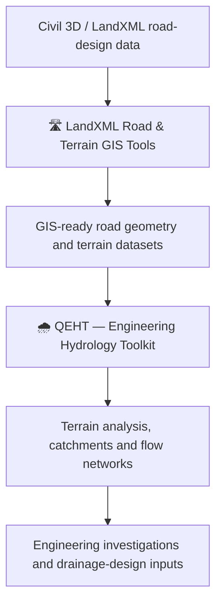

👋 Hi, I'm Edmond Akello
Civil Engineer | Engineering Hydrology | GIS | Open-Source Engineering Software
Building practical engineering tools that connect road design, terrain analysis, hydrology, and geospatial workflows.

---
🧭 About Me
I'm a Civil Engineer working at the intersection of engineering hydrology, hydraulic design, road infrastructure, GIS, and software development.
I build open-source tools that turn engineering data and established analytical methods into practical, repeatable workflows. My work spans road-design data, digital terrain models, catchment analysis, drainage investigations, and structured engineering outputs.
My goal is to make engineering computation more transparent, reproducible, testable, and useful in real projects—while keeping assumptions, coordinate systems, and the engineering meaning of results in view.
---
🚀 Featured Projects
🌧️ QEHT — Engineering Hydrology Toolkit
A QGIS Processing toolkit for terrain-based hydrological analysis and engineering hydrology workflows.
Key areas
🗻 Terrain processing: DEM conditioning and preparation for hydrological analysis.
➡️ Flow analysis: Flow direction, flow accumulation, drainage-network extraction, and stream ordering.
🌊 Catchment analysis: Watershed delineation, basin characteristics, and longest-flow-path analysis.
🛣️ Road-drainage investigations: Terrain and catchment workflows supporting crossing assessment and drainage planning.
🌧️ Hydrological characterisation: Catchment parameters and data supporting runoff estimation and design analysis.
🧪 Reproducibility and QA: Structured outputs, explicit parameters, and engineering-oriented checks.
Implementation focus: in-process GIS computation using Python, NumPy, and GDAL bindings.

🛣️ LandXML Road & Terrain GIS Tools
A QGIS Processing provider that helps make Civil 3D/LandXML road-design data usable in GIS and downstream engineering workflows.
Key areas
🗺️ Terrain conversion: LandXML TIN surfaces to GeoTIFF terrain models.
📐 Road geometry: Horizontal alignments, vertical profiles, and 3D centre lines.
📍 Stationing and sections: Station points and road cross-sections.
🔺 Surface features: TIN boundaries, feature lines, and breaklines.
🧭 Coordinate handling: Coordinate interpretation, transformations, and output CRS control.
📦 GIS outputs: Structured exports, including GeoPackage workflows.
The goal is to reduce manual conversion steps while maintaining attention to geometry, spatial reference, and data quality.

---
🧩 How the Projects Fit Together

In short: LandXML tools help bring road-design geometry and terrain into GIS; QEHT provides terrain and hydrology analysis capabilities for engineering investigations.
---
🧰 Technical Focus
Area	Tools and topics
🌧️ Hydrology & hydraulics	Catchment analysis, rainfall and runoff, drainage design, flood assessment
🗺️ GIS & terrain	QGIS, DEM processing, flow routing, watershed delineation, raster and vector analysis
🛣️ Road infrastructure	LandXML, road geometry, profiles, cross-sections, drainage investigations
🐍 Software development	Python, QGIS Processing, NumPy, GDAL, workflow automation
🧪 Engineering QA	Validation, traceable assumptions, reproducible calculations, structured outputs
---
🧠 Development Principles
🎯 Engineering-backed: Methods, assumptions, and limitations should be explicit.
🔍 Traceable: Inputs and outputs should be understandable and reviewable.
🧪 Testable: Workflows should be checked against known or independently verified results.
🔄 Reproducible: Repeatable processing is preferable to undocumented manual steps.
🔗 Interoperable: Engineering and GIS data should move between tools with clear spatial-reference handling.
🌍 Practical: Software should address real infrastructure and environmental problems.
---
🤝 Collaboration
I'm interested in open-source collaboration around engineering hydrology, QGIS, road-design interoperability, terrain analysis, and infrastructure workflows.
Explore the repositories, open an issue, or contribute ideas and test cases.
---
🏗️ Engineering knowledge + geospatial technology + open-source software
Building practical tools for real-world engineering problems.
